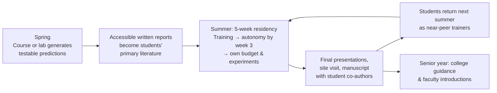

# LiNC Replication Toolkit

**LiNC: Linking high school students to research experiences in the life sciences**

An open framework for building a **multi-year, research-intensive summer program** that brings high school students into a working life sciences lab, and keeps them there, summer after summer, until they start college.

LiNC is **open to all students**. Its aim is **inclusive excellence**: a scientific community that draws on talent from everywhere, built by students who care about making science welcoming to others. You don't need to come from a particular background to help build that community, and the program selects for that commitment.

> The name is a nod to long intergenic non-coding RNAs (lincRNAs), the molecules the founding lab studies. Students *link* to research through them. Your program can keep the name, or adapt it to your own field.

---

## What makes LiNC different

Most high school outreach is **one-and-done**: a few weeks of shadowing, a certificate, and no follow-up. LiNC is built on six design principles that set it apart.

| Principle | What it looks like in practice |
|---|---|
| **Open to all, built for inclusion** | Any high school student may apply. Outreach goes where research opportunities are scarce, and selection rewards curiosity, commitment and a demonstrated commitment to inclusion in science. |
| **Start early, stay long** | Students join in 9th or 10th grade with **no prior research experience required**, and return every summer through the summer before college. |
| **Real autonomy, not shadowing** | By week three, students run experiments independently. Each manages their own **$500–$1,000 research budget**, planning and purchasing what their project needs. |
| **Authentic science** | Students work on open questions whose results feed real publications. They are **co-authors** on the resulting papers. |
| **A mentorship cascade** | Training is split into short **modules**, each taught by a mentor pair (one at the whiteboard, one at the bench), so no one person carries the summer. Faculty, postdocs, graduate students, undergraduates and *returning LiNC students* all teach. |
| **Support beyond the summer** | Alumni receive college guidance, essay mentoring, and introductions to research faculty at the university they attend. |

## How the pipeline fits together

The model works best when your lab already produces a steady stream of testable hypotheses, for example from a course-based research experience (CURE) you teach or from computational work in your group. See [Connecting a course to the summer](docs/06-course-to-lab-link.md) for options if you don't teach a course.

## Quick start

If you're deciding whether this is feasible for your lab, read these three first:

1. [**Why LiNC**](docs/01-why-linc.md): the problem, the evidence, and the design principles.
2. [**Planning calendar**](docs/02-planning-calendar.md): what to do and when, starting about 12 months out.
3. [**Funding and budget**](docs/04-funding-and-budget.md): what a summer costs, how to fund it, and a low-cost starting version.

Then work through the full guide in order.

## The guide

| # | Section | What you'll get |
|---|---|---|
| 01 | [Why LiNC](docs/01-why-linc.md) | Rationale, design principles, what success looks like |
| 02 | [Planning calendar](docs/02-planning-calendar.md) | A month-by-month timeline for your first year |
| 03 | [Institutional setup](docs/03-institutional-setup.md) | Working with your institution's office for programs involving minors |
| 04 | [Funding and budget](docs/04-funding-and-budget.md) | Cost categories, funding mix, scaling up or down |
| 05 | [Recruitment and selection](docs/05-recruitment-and-selection.md) | Where to find students, the application, how to choose |
| 06 | [Connecting a course to the summer](docs/06-course-to-lab-link.md) | Turning a CURE or lab project into student-ready research |
| 07 | [The five-week summer](docs/07-summer-curriculum.md) | Week-by-week structure, meetings, presentations |
| 08 | [Student research budgets](docs/08-student-budgets.md) | How students plan, justify and track spending |
| 09 | [The mentorship cascade](docs/09-mentorship-cascade.md) | Teaching in modules with mentor pairs; roles for every tier of mentor |
| 10 | [Multi-year retention](docs/10-multi-year-retention.md) | Bringing students back and growing their responsibility |
| 11 | [Beyond the summer](docs/11-beyond-the-summer.md) | College guidance and undergraduate research placement |
| 12 | [Publishing with high school students](docs/12-publishing.md) | Authorship, manuscript structure, timelines |
| 13 | [Assessment](docs/13-assessment.md) | Pre/post surveys, longitudinal tracking, reporting results |

## Ready-to-use materials

| Folder | Contents |
|---|---|
| [`templates/`](templates/) | Module catalog, application form, selection rubric, welcome letter, family information sheet, five-week schedule, budget proposal and tracker, presentation rubric, accessible report template, mentor expectations, faculty introduction email |
| [`assessment/`](assessment/) | Matched pre- and post-program surveys, a returning-student module, a data template and an analysis script |

Everything is written in plain Markdown or CSV so you can copy it into Google Forms, Word or your institution's systems.

## Outcomes from the founding program

The first four summers of LiNC (2023–2026) produced:

- **High retention.** Students returned year after year, completing many more student-summers than there were students.
- **100% college matriculation into STEM majors**, at institutions including Columbia, UC Berkeley, Rice, the University of Michigan and Miami University.
- **Peer-reviewed publication with high school co-authors:**
  Bose E, *et al.*, Jones AN. *Bioinformatic and experimental characterization of the RBM15 RNA binding protein.* Journal of Structural Biology (2025). [doi:10.1016/j.jsb.2025.108264](https://doi.org/10.1016/j.jsb.2025.108264) · PMID: 41297729
- **Rapid growth in demand**, from 3 applicants in the first year to more than 50 applicants for 6 positions.
- **Measurable gains** on pre/post surveys in experimental confidence, sense of belonging in the lab, and commitment to a life sciences degree.
- **Adoption by other labs**, which are using this framework to start their own programs.

## Using LiNC in your lab

Running a version of LiNC? Please [add your lab to ADOPTERS.md](ADOPTERS.md). Tracking adoption helps make the case for funding this model nationally. Suggestions and improvements are welcome; see [CONTRIBUTING.md](CONTRIBUTING.md).

## How to cite

If you use or adapt this toolkit, please cite it. Use the **"Cite this repository"** button on the right side of this page, or:

> Jones, A.N. (2026). *LiNC Replication Toolkit: Linking high school students to research experiences in the life sciences.* GitHub. https://github.com/drjsoundsgood/linc-replication-toolkit

## License

The contents of this toolkit are shared under the [Creative Commons Attribution 4.0 International License (CC BY 4.0)](LICENSE). You may copy, adapt and redistribute it for any purpose, including at your own institution, provided you give appropriate credit.
