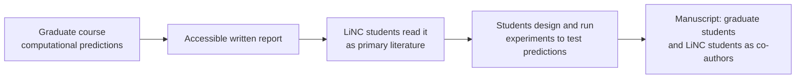

# 06 · Connecting a course to the summer

LiNC students need projects that are **real, open and testable in five weeks**. The founding program solves this by linking the summer to a graduate course, so that each spring's classroom work becomes the next summer's experiments.

## The founding model: a course-based research experience (CURE)

In the spring, the PI teaches a graduate course in which students carry out a **course-based research experience (CURE)**. For the second half of the semester, graduate students work in pairs to make computational predictions about molecular systems. In the founding program these were long non-coding RNA–protein interactions, studied with public databases and structure-prediction tools.

The CURE ends with three products:

1. **Presentations**, peer-reviewed by classmates with a structured rubric (see [templates/presentation-rubric.md](../templates/presentation-rubric.md))
2. **A written report in the form of a manuscript**
3. **The same findings, written in accessible language** that a high school student can read and understand

That accessible report becomes the LiNC students' **primary literature**. Before entering the lab, they read it to understand the system, the predictions and the experiments that could test them. Over the summer, they test those predictions at the bench.

### Why this works
- **Students start with a real question.** They aren't assigned busywork; they're testing predictions no one has tested yet.
- **The reports are written for them.** Graduate students practice explaining science to a general audience, and high school students get an entry point they can actually read.
- **Everyone publishes.** The graduate reports form the skeleton of a manuscript, and the LiNC students' experiments complete it. Both groups are co-authors.
- **It renews itself.** Each spring generates a new set of questions.

A template for the accessible report is in [templates/accessible-report-template.md](../templates/accessible-report-template.md).

## If you don't teach a course

The course link is powerful but not required. Other sources of good summer projects:

| Source | How it works |
|---|---|
| **Computational work in your lab** | A rotation student, undergraduate or postdoc produces predictions in the spring and writes the accessible report. |
| **A colleague's course** | Partner with a faculty member whose course produces predictions your lab can test. |
| **Existing lab projects** | Choose a modular sub-question from an ongoing project, for example testing a set of variants, conditions or constructs. |
| **Public datasets** | Students start from a published prediction or dataset and test part of it experimentally. |

Whatever the source, have someone write a **2–4 page accessible summary** before the summer starts.

## What makes a good LiNC project

- **Testable in five weeks**, with useful results even if only part of it works
- **Built from a small set of techniques** students can master in about two weeks
- **Safe** for minors under supervision (check with your safety office)
- **Open-ended enough** that students can propose their own next experiments
- **Parallelizable**, so pairs of students can test different predictions with the same methods
- **Connected to a publishable question** in your lab

---
← [05 · Recruitment and selection](05-recruitment-and-selection.md) · Next: [07 · The five-week summer →](07-summer-curriculum.md)
