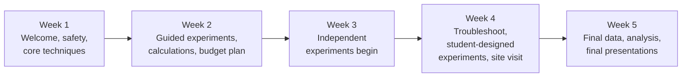

# 07 · The five-week summer

Students commit **20 hours per week** for **five weeks**, working in **pairs or trios**. The program moves deliberately from training to independence: **by week three, students run their own experiments.**

A printable schedule is in [templates/five-week-schedule.md](../templates/five-week-schedule.md).

## The arc

## Week by week

### Week 1: Welcome and foundations
- Welcome, lab tour, introductions to every lab member
- **Pre-program survey** on day one (see [Assessment](13-assessment.md))
- Lab safety training (required before bench work)
- Read and discuss the accessible project report together
- Learn core skills: pipetting, making solutions, the calculations behind them, keeping a lab notebook
- Returning students lead parts of the training

### Week 2: Guided experiments
- Run the core techniques alongside a mentor, with mentors gradually stepping back
- Practice reagent and sample calculations independently
- **Draft the research budget**: what to test, what is needed, what it costs (see [Student research budgets](08-student-budgets.md))
- First **subgroup meeting**: informal update on what's been learned

### Week 3: Independence
- Students run experiments **on their own**, with mentors nearby for questions
- Budget approved; students place their first orders
- Things go wrong. That's the point. Mentors ask "what do you think happened?" before offering answers.

### Week 4: Ownership
- Students troubleshoot and **design their own follow-up experiments**
- Second subgroup meeting: data so far and proposed next steps
- **Site visit to another university:** tour a lab, hear about its research, and give informal talks about LiNC projects. Lab undergraduates come along as "buddies" to talk about college applications and undergraduate research.

### Week 5: Results and presentations
- Final experiments and data analysis
- Prepare and rehearse final presentations, with feedback from mentors and returning students
- **Final presentations** to the lab. Invite families, and invite faculty at the colleges seniors are heading to.
- **Post-program survey**
- Celebration

## Recurring meetings

| Meeting | Frequency | Format |
|---|---|---|
| **Subgroup meeting** | Every two weeks | Informal: students present progress to their subgroup and get feedback |
| **Full lab group meeting** | Weekly | Students attend alongside the whole lab; in later weeks they present |
| **Mentor check-in** | Daily | Brief: plan for today, problems from yesterday |
| **PI check-in** | Weekly | Short conversation with each pair: how is it going, what do you need? |

## Presentations: a ladder of growing audiences

Students present repeatedly, to progressively larger and less familiar audiences:

1. Subgroup meetings (informal, small)
2. Full lab group meeting
3. Informal talks during the site visit to another university
4. Final presentations to the lab, families and invited guests

By the end, presenting science is familiar, not frightening. Use [templates/presentation-rubric.md](../templates/presentation-rubric.md) to give structured feedback.

## Principles for the summer

- **Let students make mistakes.** Troubleshooting a failed experiment teaches more than a perfect one.
- **Ask before answering.** "What do you think?" builds scientific reasoning.
- **Value their ideas.** When a student proposes an experiment, take it seriously, and run it if it's feasible.
- **Make returners teachers.** Returning students train new ones; teaching consolidates what they know.

---
← [06 · Connecting a course to the summer](06-course-to-lab-link.md) · Next: [08 · Student research budgets →](08-student-budgets.md)
