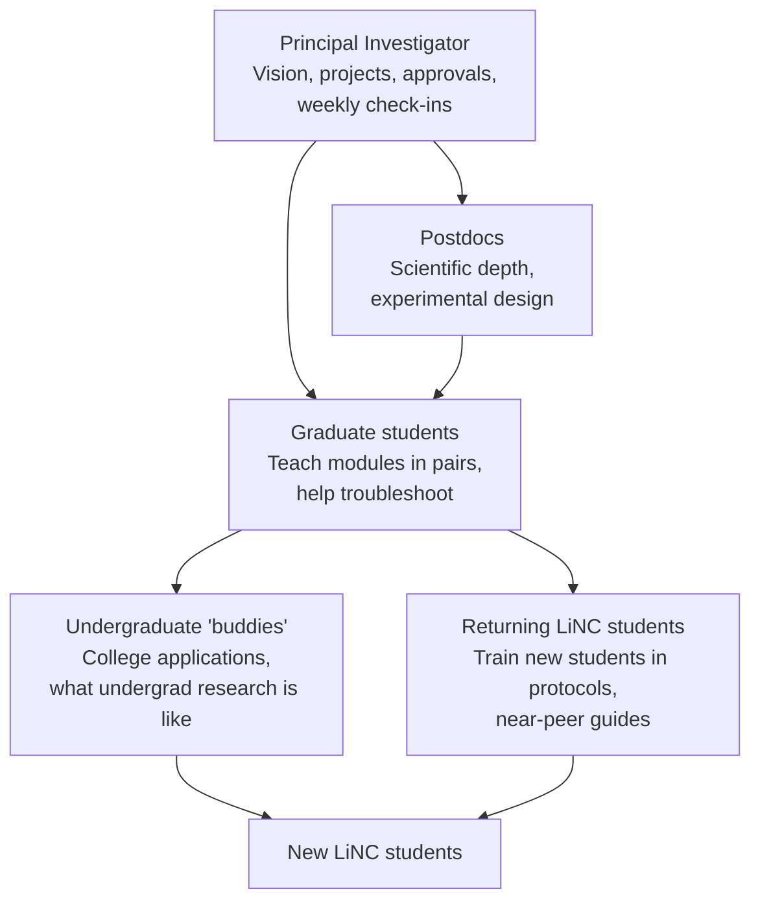

# 09 · The mentorship cascade

In LiNC, **mentors come in all shapes and sizes**. Every member of the lab has a role, and so do returning students. This spreads the work, so no single person carries the program, and it gives students people to learn from at every career stage.

## Roles

| Role | Responsibilities | Approximate time during the summer |
|---|---|---|
| **PI** | Chooses projects; approves budgets; weekly check-ins with each pair; attends presentations; leads college guidance | 5–10 hours/week |
| **Postdocs** | Help design experiments; answer deeper scientific questions; review data | 2–5 hours/week |
| **Graduate students** | Teach one or two modules with a partner; help students troubleshoot during independent work | A few sessions over the summer |
| **Undergraduates** | Co-teach modules; "buddies" who share experience with college applications and undergraduate research; join the site visit | A few sessions over the summer, plus buddy time |
| **Returning LiNC students** | Train incoming students in protocols they've mastered; co-teach modules they've completed; present progress to the team | Part of their own 20 hours |

## Teaching in modules

Rather than assigning one mentor to a student for the whole summer, LiNC breaks the training into **modules**: short, self-contained units, each covering one technique or concept. Each lab member owns one or two modules. **This keeps the burden off any single person.** No graduate student loses a whole summer of their own research, and students learn from many people.

### Mentor pairs: one explains, one demonstrates

Each module is taught by a **pair of mentors**:

| | Whiteboard mentor | Experimental mentor |
|---|---|---|
| **Role** | Explains the concept: what the technique is, why it works, what the results mean | Leads the hands-on work at the bench |
| **Example** | Draws how a protein binding to RNA slows it down on a gel | Walks students through setting up and running the gel |

Students get the "why" and the "how" from two people, and each mentor plays to their strengths.

### Show, do, watch

At the bench, each module follows a gradual release:

1. **Show.** The experimental mentor demonstrates, explaining each step.
2. **Do.** Students perform the technique with the mentor alongside.
3. **Watch.** Students do it on their own while the mentor observes, stepping in only if needed.

After the module, students can use the technique independently in their own projects.

### Building a module set

Group modules into arcs that tell a complete scientific story. The founding lab's modules show students how to **make an RNA, make a protein, study their structures, and study how they interact**. See [templates/module-catalog.md](../templates/module-catalog.md) for that example set and a blank template for planning your own.

Not every student takes every module. Students take the modules their project needs, and returning students take more advanced modules in later summers.

## Pairing and overlap

- Students work in **pairs or trios**.
- Where possible, pair a **returning student with a new student**, so the experienced student trains the newer one. Cohorts overlap, and knowledge passes down each year.
- Assign each student pair a **point person** in the lab for day-to-day questions during independent work, and an **undergraduate buddy**. Training itself is spread across the module teachers.

## Preparing your mentors

Mentoring high school students is different from mentoring undergraduates. Before the summer:

- Share [templates/mentor-expectations.md](../templates/mentor-expectations.md) and discuss it at a lab meeting.
- Make sure every mentor has completed required **youth-protection training** and background checks (see [Institutional setup](03-institutional-setup.md)).
- Assign modules and mentor pairs, and schedule them. Each pair decides who takes the whiteboard and who takes the bench.
- Have each pair do a dry run of their module, ideally on a lab member who doesn't know the technique.
- Practice asking questions instead of giving answers.

## Recognizing your mentors

Mentoring takes time. Make it count:
- Mentors are **co-authors** on resulting publications where they contribute.
- Write up their mentoring in fellowship and job recommendation letters.
- Encourage graduate students and postdocs to list LiNC mentoring on their CVs, with numbers (students mentored, presentations supervised).

## What students say

In the founding program's surveys, students rate how easy it is to interact with each type of mentor. Students often find it easiest to talk to mentors closest to their own stage. That's why the undergraduate and returning-student tiers matter.

---
← [08 · Student research budgets](08-student-budgets.md) · Next: [10 · Multi-year retention →](10-multi-year-retention.md)
