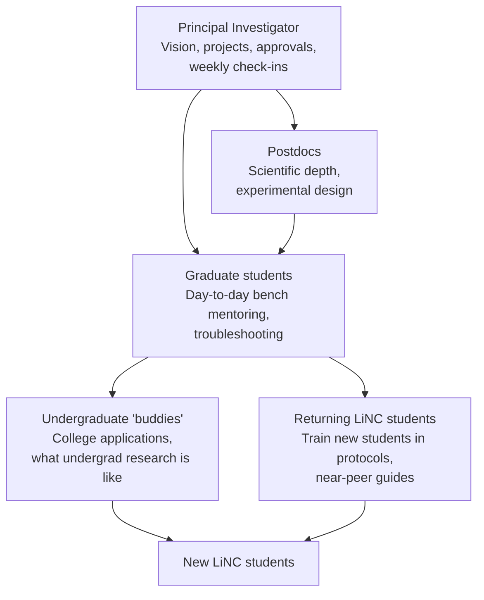

# 09 · The mentorship cascade

In LiNC, **mentors come in all shapes and sizes**. Every member of the lab has a role, and so do returning students. This spreads the work, so no single person carries the program, and it gives students people to learn from at every career stage.

## Roles

| Role | Responsibilities | Approximate time during the summer |
|---|---|---|
| **PI** | Chooses projects; approves budgets; weekly check-ins with each pair; attends presentations; leads college guidance | 5–10 hours/week |
| **Postdocs** | Help design experiments; answer deeper scientific questions; review data | 2–5 hours/week |
| **Graduate students** | Primary bench mentors: train techniques, supervise, troubleshoot, review notebooks | 5–10 hours/week each |
| **Undergraduates** | "Buddies": share experience with college applications and undergraduate research; help in the lab; join the site visit | 2–5 hours/week |
| **Returning LiNC students** | Train incoming students in protocols they've mastered; lead parts of week-one training; present progress to the team | Part of their own 20 hours |

## Pairing and overlap

- Students work in **pairs or trios**.
- Where possible, pair a **returning student with a new student**, so the experienced student trains the newer one. Cohorts overlap, and knowledge passes down each year.
- Assign each pair a **primary graduate or postdoc mentor** and an **undergraduate buddy**.

## Preparing your mentors

Mentoring high school students is different from mentoring undergraduates. Before the summer:

- Share [templates/mentor-expectations.md](../templates/mentor-expectations.md) and discuss it at a lab meeting.
- Make sure every mentor has completed required **youth-protection training** and background checks (see [Institutional setup](03-institutional-setup.md)).
- Agree on how to step back: show, then do together, then watch, then let go.
- Practice asking questions instead of giving answers.

## Recognizing your mentors

Mentoring takes time. Make it count:
- Mentors are **co-authors** on resulting publications where they contribute.
- Write up their mentoring in fellowship and job recommendation letters.
- Encourage graduate students and postdocs to list LiNC mentoring on their CVs, with numbers (students mentored, presentations supervised).

## What students say

In the founding program's surveys, students rate how easy it is to interact with each type of mentor. Students often find it easiest to talk to mentors closest to their own stage. That's why the undergraduate and returning-student tiers matter.

---
← [08 · Student research budgets](08-student-budgets.md) · Next: [10 · Multi-year retention →](10-multi-year-retention.md)
